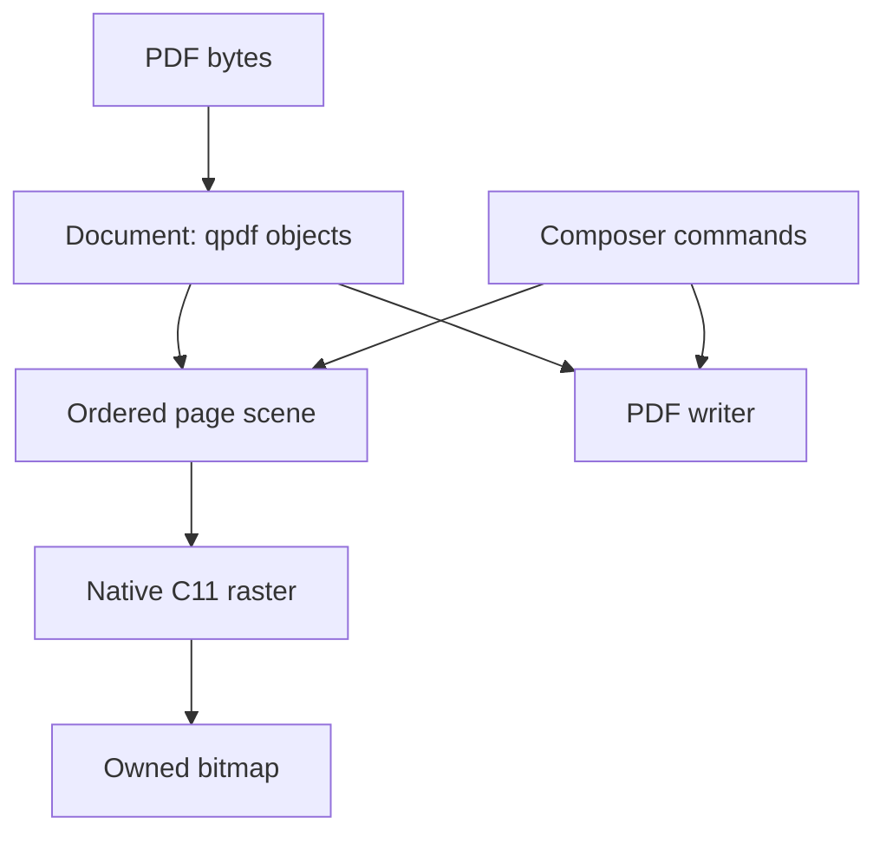

# QuantaPDF：功能规划重置

日期：2026-11-03。本文是当前设计与功能清单；旧 issue 阶段和旧架构规范转为历史记录。

## 决策

1. **Fail fast or let it fail。** 功能调用或脚本遇到真实错误就结束并传递原因。
   不吞错，不伪造成功，不修复后重试，不切换后端/工具链继续运行。
2. **任何代码和脚本都不需要防御式编程。** 删除重复检查、宽容包装、恢复分支、
   环境探测和预防性框架。PDF 语法解析由一个责任边界完成；资源释放由所有权完成。
3. **没有任何 API/ABI 需要兼容。** 可以直接改名、删函数、改结构、改枚举、改所有权。
   同一次修改更新当前头文件、实现、仓库调用方与测试，不增加兼容层。
4. **围绕 PDF 功能开发。** 不再把每一种固定绘制顺序拆成一个阶段、一条私有 route、
   一个“继续拒绝”的验收门禁。现有渲染、字体、几何和测试成果按实际用途复用。
5. **历史成功不等于完整产品覆盖。** 重置时的 69 项 native 测试和已合并代码是事实，
   不是要求永远保持 69 项，也不是所有公开 API、任意 PDF 或发布包均已验收。

## 事实基线

- master：`c68b89346aa2e3f01cd4c17daeee6aea7cdbd3b0`。
- [master CI #2407](https://github.com/qigao/QuantaPDF/actions/runs/41626185987)：
  Linux Release、Linux ASan/UBSan、macOS ARM64、Windows LLVM-MinGW 各 69/69，
  Windows 当前导出检查通过。
- [#607](https://github.com/qigao/QuantaPDF/pull/607) 的反向 sibling Bitmap/receipt
  增量已通过 PR CI，但尚未合并，不能计入 master 功能。
- qpdf 文档操作、编辑、Composer、文本提取等已有代码；当前顶层 CMake 只注册
  `tests/native`。旧 `tests/CMakeLists.txt` 中的完整 SDK 回归没有因此自动获得验收。
- 重置时已打开文档持有 qpdf 对象，而 native page bridge 又交出原始字节并由 Source
  重新解析；带非空密码的 render view 被拒绝。下述 A1 增量消除了这条重复路径。
- 现行公开版本号、`struct_size`、V1/V2/V8/V9/V10 等标记和导出基线仍在代码中；
  本次重置取消其兼容义务，实际代码清理由 A1 完成，本文不声称已经删除。

## A1 当前实现增量

#609 已合并为 `0eb5101f666d6dacde29b4eca45f22b16709699b`；独立 master
[Native CI #2413](https://github.com/qigao/QuantaPDF/actions/runs/41751809313) 通过。
这是本次继续开发的基线，不能代替后续 HEAD 的测试。

- Native renderer 直接借用已打开、已解密的 qpdf Document 和所选 Page，
  Source 不再重开原始文件；已删除字节/password view、版本化 Page/Bitmap bridge
  和重复的私有 facade。独立原件 Source 测试仍可自行打开一次文档。
- Page 持有 Document 引用；调用方 close Document/drop Context 后 Page 仍可渲染。
  Source IR 独立持有图像/字体数据，完成的 Bitmap 独立持有像素和 Context。
- `quantapdf_render_options` 使用当前完整字段，已删除 `struct_size` 协商；
  渲染调用链不再选择 V8/V9/V10，也不再重复检查 UserUnit。
- 加密多页、实际对象/资源变更、释放顺序、错误传播、完整 RGB 验收位于
  `quantapdf.native_opened_document`，复用现有 native 测试可执行文件。
- Page 的原始 `/Contents` 现在由 qpdf 直接拼接、解密、解码和解析；
  已删除 Source 自行拼接的 decoded bytes 和空 qpdf 内容文档。
  RAW、Flate、ASCIIHex、ASCII85、RunLength、filter array/chain，以及不同编码的
  多内容流已通过独立 RGB 用例；这不是 Image XObject codec 的扩展。
- 公开渲染不再将 4 个内容流或 64 KiB 当作页面准入上限。显式内部调用方的流数
  预算在 qpdf 内容解析前核对，解码字节预算由 qpdf 的 contentSize 回调在解释前核对；
  该字节预算不宣称限制 qpdf 解码缓冲区的瞬时内存。
- `quantapdf.native_content_streams` 验证 144 次公开 RGB 输出、1/3/17 个流、
  跨流 q/Q、AES-256、资源释放和错误传播；`quantapdf.native_content_stream_oom`
  在同一打开的文档上验证 48 次真实 qpdf 遍历分配失败、192 次 Source 发布分配失败，
  以及 144 项 N/N−1 字节/流数/操作数预算检查，复用现有两个测试可执行文件。
  六组旧 64 KiB padding 拒绝用例已改为 72/96/144 DPI 的完整 RGB 等价对照；
  其他未实现绘制、几何及资源错误用例保留。
- Source 只保留 `quantapdf_qpdf_page_to_ir`：接收已打开 Document、所选页和实际工作预算。
  头文件与实现改为 `qpdf_page_ir.h/.cpp`；16 个字节式/版本化/私有样例入口、
  V1–V10 策略矩阵和历史能力开关已删除。测试通过当前 Document 打开一次，使用同一
  Page 入口；不再以“旧版本必须拒绝新能力”作为验收。
- 页面预算不含旧 `max_pdf_bytes`，不再按 2 MiB 文件总大小拒绝已打开文档。
  内容流用例包含明文与 AES-256 的大于 3 MiB 文档，仍核对全部 RGB、释放顺序、
  实际 qpdf 遍历/Source 发布失败与页面工作预算。
- 两次 Image 绘制现在可分别处于 Clip 内和实际 Q 恢复后的 GS0；使用同一顺序 C11
  合成器，不增加绘制 route。测试核对当前 IR 资源归属、逐个 Source 分配失败、
  错误 GS 绑定的空输出，以及 72/96/144 DPI、Rotate/Crop/选页后的完整公开 Bitmap。
- 三个未注册的 PDFium 时代 Source 版本隔离测试与其旧注册已删除。有价值的单/双
  Image、Q 恢复、Image+Path 和混合顺序原件在现有 native 测试中验证当前输出。
- 其他 API 的尺寸协商，以及固定内容/绘制顺序、字体、几何、预算和 DPI 限制尚待
  A1/A2 后续清理。此处删除的是历史接口准入，不声称通用有序 Scene 或完整 PDF 渲染完成。

## A2 当前实现增量：动态 q/Q 状态

- 开发基线为 #610 合并后的 `a3c91f0f0f42e5f0b352e172ae4fa04182de3409`，
  独立 [master CI #2415](https://github.com/qigao/QuantaPDF/actions/runs/41759120463)
  四配置各 72/72；这份历史结果不代替本增量的精确 HEAD 验收。
- Fill/Image 内容解释器用一个动态栈帧保存 CTM、填充/描边颜色、Clip 身份和当前解释的
  描边参数，替代三个必须同步的并行 vector；Q 一次恢复该帧。G 的黑白颜色在实际
  解析位置记录，删除 TeXample 识别后的颜色补记，保留原件的完整像素验证。已删除这条解释器上
  16 层 q/Q 和 512 token 的准入检查，普通状态序列不再受其限制。
- 当前路径保留在内容解释器中，q/Q 不保存或清空它；构建路径中途可以保存/恢复
  CTM 和颜色，后续线段按各自出现时的 CTM 冻结，最终 paint 使用恢复后的颜色。
  合法的 w/J/j、M/d、G/RG/K 与 opaque gs 也不再因为路径尚未绘制而被拒绝。
  原有相应用例改成正常 Fill 的完整 RGB 对照；非法值、未实现 paint 仍直接失败。
- 真实原件覆盖 2/16/17/257/4097 层、长状态序列、三个不同编码的 Contents、
  AES-256、继承 Resources、第二页选择、Clip 内外的 Fill/Image，以及首次绘制后
  再增长状态栈，以及未绘完路径中途发生实际栈扩容。公开 Bitmap 在 72/96/144 DPI 核对全部 RGB，并在原始 owner 释放后复核。
- 每个实际 vector 扩容位置和每个 IR 发布分配位置都注入失败；失败保留 NOMEM，
  不发布 IR。内容字节/流数/绘制预算继续按实际工作核对。多余 Q、未闭合 q、
  非法 cm 和晚到未实现操作仍使整个页面失败且不发布 Bitmap。七组旧 token 超限
  拒绝用例改为 21 项完整 RGB 等价对照，跨流 512/513 token 边界也按实际像素验收。
- 这是通用内容状态的第一项实现。Text 内部状态机及其限制、四笔 C11 固定容器、
  精确绘制顺序分类、一般 Clip DAG、路径/Stroke 和坐标限制仍属于 A2/A3 后续工作。
  不以删除 vector 深度检查宣称任意页面或任意绘制序列已经实现。

## 单一执行模型

Document 中已解析、已解密的 qpdf 对象是文件结构的唯一权威；Graph/快照是确有用途的
投影，不再发展另一套文档权威。渲染直接消费所选 Page/Resources，不为调用另一个
旧接口而重新序列化、重新打开同一个 PDF。

一个内容解释器按源顺序处理 graphics state、文本、路径、图像和 Form 调用。
字体解码是解释器的服务，不在第一次 BT 时换成另一套受限内容状态机。
Scene 保存真实绘制顺序及每次 paint 的 CTM、Clip、颜色和资源引用；编译器按操作类型
处理，不按“三笔/四笔、正序/反序、某一原件”选择 profile。

Renderer 使用同一套几何、采样和合成实现。Form、透明组和 pattern 所需的中间表面
属于这些功能本身；不通过另一个 renderer 或整页重绘来绕过缺失功能。图像保留完整
仿射 placement，不能把旋转后的轴对齐包围盒当作原图拉伸区域。

失败在原位置结束当前操作。只在 C 边界转换一次实际 backend 错误；保留错误原因。
临时对象随作用域释放，成功结果在完成后发布；不为继续使用一个失败操作构造恢复层。

## 实际欠缺与工作包

| 工作包 | 当前事实 | 要补的功能 | 优先级 |
| --- | --- | --- | --- |
| A1 API 与执行模型 | C11 facade、Context/owner、qpdf backend、native renderer 已存在；版本包装和多层准入仍多 | 一套当前 API；删除兼容 factory/provider/record 协商；直接复用打开的文档；统一所有权、错误和脚本失败行为 | P0 |
| A2 通用内容、路径与坐标 | 已有真实 Path/Image/Text/Clip、曲线、Stroke 原件和独立像素结果；Source 仍受固定 profile、4-paint 等限制 | 任意实际绘制序列、通用 q/Q/CTM/Clip；完整路径/Stroke；一般页面几何、DPI/ROI/RGBA；合理的动态/分块绘制 | P1，功能实现首先推进 |
| A3 字体、文本与提取 | 已有 TrueType 子集/轮廓、CID FontFile2 与部分文字操作；Composer 部分能力不能当作 Source 通用支持 | 多字体、多段 Text、完整 text state/positioning；Encoding/CMap/ToUnicode；常见嵌入字体与标准字体；提取/搜索/选区几何 | P1 |
| A4 图像与色彩 | RAW/Flate 8-bit Gray/RGB 和部分 predictors 已验收；其他路径有代码不等于 Source 已能渲染 | JPEG、扫描图像、更多位深/Decode/色彩空间、inline image、image mask/SMask；完整图像仿射采样 | P1 |
| A5 Form、透明度与外观 | 部分 writer/Composer 数据结构已存在；native 整页解释/渲染覆盖不足 | 嵌套 Form、Resources/BBox/Matrix；alpha/blend/group/soft mask；pattern/shading；annotation/widget appearance | P1 |
| A6 文档操作、编辑与生成 | 打开、页面操作、编辑、导出、Composer、安全观察等已有实现，完整回归未纳入当前门禁 | 以当前 API 接通并验证 open/read/edit/export/merge/compose；修正文档树与 writer 语义；简化失败编辑；保证生成文件的实际行为 | P1 |
| A7 Beta 测试、文档与交付 | 当前 native CI 全绿；旧验收文档过时，CI 没有 SDK 发布产物 | 当前功能矩阵、已有 SDK 回归迁移、真实文档集合、发布包/清单/许可/校验和、对应平台运行结果 | P0，与功能并行 |

### A1：直接 API 与失败行为

- 保留 C11 入口作为外部调用方式，qpdf/C++ 与 C11 像素内核继续各司其职；这不冻结
  任何现有名字、参数、结构布局、枚举值、package target 或所有权形式。
- 合并重复工厂和带版本的入口，去掉 append-only、MIN_SIZE、旧 ABI 适配和迁移模式。
  版本标识只说明构建身份；导出清单只对应当前头文件，可随 API 一起更新。
- 取消“为保持历史而保留”的 profile/provider 分支；当前 Source 不再重新打开已有文档。
- PDF 解析错误、缺失实现、文件 I/O、解码或分配失败在真实操作点直接返回/抛出；
  C 入口转换一次。内部遵守已声明的调用条件，不逐层重复检查或代替调用方修复参数。
- 脚本执行原生命令失败即退出。缓存复用相同输入的正常构建，不通过换版本、换后端、
  换工具或执行探测工程来“恢复”一个失败构建；清理现有自动 retry 和重复退出码包装。

### A2：从固定样例路线变成通用页面

- 有序操作容器取代固定四笔数组/精确顺序分类；取消把 4 paints、64 glyphs、512 edges、
  8M samples 等实验常量当作能力边界。先实现合适容器和算法，再删除相关限制。
- 同一个解释器处理路径、text state、image、资源和作用域；paint 保存定义时的状态。
- 覆盖 fill/stroke/combined paint、dash、hairline、cap/join/miter、退化路径、任意
  affine CTM、曲线与 nested Clip。保留正确的 glyph∩Clip 覆盖语义。
- 一处页面坐标模型服务 render、text、annotation：Media/Crop、负原点、Rotate、
  UserUnit、一般小数、任意请求 DPI、ROI 与输出 RGB/RGBA。
- 处理旧 #360 的真实尺寸错误：`2.375/12.375`、`UserUnit=7` 的数学宽度应产生
  70 像素，而不是 71；测试原始十进制与整页结果，不增加 epsilon 兼容模式。
- 通过可用内存和实际操作决定成功/失败，必要时采用 tile/band/span 算法。
  不能让增加真实绘制次数自动变成“unsupported profile”。

### A3：真实 PDF 文字

- 复用现有字体/轮廓代码，验证多字体、多 Text object、Tj/TJ 与完整 text state 的组合，
  包括字距、位置矩阵、旋转、文字渲染与文字 Clip。
- 明确标准字体、嵌入 TrueType、CID、Type1/CFF、Type3、纵排的逐项状态；完成常见
  TrueType/CID 后继续扩展其余类型，不把一个 Roboto 样例当作整体字体覆盖。
- 原 PDF 按其编码、glyph 与 advance 解释，不对导入 PDF 重新 shaping。
  Composer 的 Unicode shaping/换行是创建文字功能，单独实现。
- ToUnicode/Encoding/CMap、提取、搜索与选区坐标通过实际文件测试；CJK 是明确用例。
  字体缺失/未实现就返回具体错误，不做猜测式字体替换回退。

### A4：真实图像

- 首先完成常见 JPEG 与 Flate Gray/RGB、更多位深、CMYK/Indexed/Decode/predictors。
- 再补扫描 PDF 的 CCITT/JBIG2、JPX，及 ICCBased/Lab/Separation/DeviceN 等色彩路径；
  解码和色彩转换按明确 PDF filter/color space 分派，不轮流尝试 codec 猜格式。
- Inline image、stencil、SMask 与 alpha 在正确坐标和合成模型中工作。
- 已有库能提供的 codec 作为明确依赖集成；不为重新造 codec 延后 PDF 功能。

### A5：复用通用绘制来做复合图形

- Form 调用保存/恢复状态，使用对应 Resources、BBox 与 Matrix；复用同一解释器与 Scene。
- 实现 ExtGState 的 alpha/blend、isolated/knockout group、soft mask 及所需合成空间。
- 实现常见 tiling pattern、axial/radial shading，再扩展其余 shading 类型。
- Annotation/widget 的 AP 使用同一 Form/paint 路径；包含表单值后的外观更新与 flatten。
  写出 AP/透明度字典不代表 native renderer 已完成这些像素。

### A6：验证已有文档能力并补具体缺口

- 让已解密的打开文档直接参与渲染/提取，不因保存了密码字符串就拒绝 render。
- 页面选择、crop/trim/split、合并、注释/表单编辑、导出和 rewrite 用真实输出重开验证。
- 页面树的 Parent/Count、资源引用和 writer 更新由实际操作正确维护；不另造一层
  通用验证平台来代替实现这些语义。
- 编辑可以在私有工作文档上执行，失败就结束并释放它，成功输出新结果；不建立
  多层 undo/自动修复/失败 session 恢复协议。
- Composer、字体子集、SVG/导航等按实际支持项回归；分别报告“能写出”与“能渲染”。
- 增量保存、签名生成/验证、PDF/A/UA、OCR 是后续功能，不假定现有实现已认证。

### A7：按承诺功能发布

- 将旧 SDK 中仍有产品价值的测试迁入现有测试组织，按新 API 修改；不重新建立
  installer/consumer 工程，不使用已移除的 PDFium，测试数可自然增减。
- 每项能力分别记录：代码存在、当前测试通过、真实文件通过、目标发行包通过。
  未执行的测试、私有原语或一份格式错误预期都不能当作完整公开功能。
- 使用可在仓库复现、可分发的文档，包含正常多笔绘制、中文/多字体、扫描图像、
  透明图形、页面几何与编辑后的重开。旧 #271/#336/#343 的未入库/来源未确认样本
  不计入现有覆盖，也不作为实现核心功能的前置条件。
- LLVM/LLVM-MinGW、ccache 与 curl 保留；CI 命令失败立即失败。发布包包含当前
  header/library、实际依赖、CMake target、许可、构建身份和校验和。
- 统一 README、SDK 合同、能力表和实际测试注册；没有历史 API/ABI 兼容承诺。

## 实施次序与 Beta

先做 A1 的接口/执行模型清理，并以 A2 的一般页面操作流替代 profile 枚举。
随后优先让常见文字与图像通过 A3/A4 接入；A6 的已有 API 回归、A7 的文档/交付同步推进。
A5 使用已经通用化的解释器和 raster 完成复合图形，不另开新后端。

开发者 Beta 的最低有用范围是：清晰的当前 API、正常多笔页面、常见嵌入文字与图像、
基本文档导出/合并与生成、对应实际文件测试和可用发行包。发布能力表明确排除尚未
实现的字体、透明度或高级 PDF 特性；无需等所有后续功能完成。
面向普通 PDF 的阅读/渲染 SDK 则需要补齐常见 Form、透明度、字体与扫描图像。

每个实现 PR 完成一个可用功能或删除一组实质冗余，记录当前 HEAD 的实际结果。
不再为了一个绘制排列追加一个“私有 Source → 私有 compiler → public qualification”
三段 issue 链，也不再以旧 API 不变或固定测试数量作为验收目标。

## 关闭旧 issue 的归属

旧 issue 因规划被替代而关闭，不表示未实现功能已经完成。历史正文和 CI 证据保留。
本轮不重新拆出一批阶段 issue；A1–A7 是当前统一工作清单。

| 旧项 | 新归属 |
| --- | --- |
| #145 #154 #208 #213 #214 #360 #530 #570 #580 #584 | A2，文字/图像/复合图形分别归 A3/A4/A5；不继承旧阶段约束 |
| #427 | A4，已有 RAW/Flate 是基础，通用图像功能继续实现 |
| #146 #149 #153 | A1/A6，保留具体文档/writer 问题，停止兼容性迁移门禁 |
| #160 | A6 后续增量保存功能 |
| #233 #271 #336 #343 | A7，实际文件、几何回归与来源记录 |
| #161 #169 | 并行处理与语言绑定列入 Beta 后续；不以旧 ABI 或生成框架为前提 |
| #155 #157 #158 #162 #163 #164 #166 #167 #170 #172 #174 #175 | 原反射/arena/plugin/schema/index/cache/隔离宿主/服务/观测/协商/工作流/事件平台规划撤出当前产品路线；必要的所有权和首个错误信息直接在功能内实现 |

进程隔离、HTTP/分布式服务、事件总线和工作流属于使用 SDK 的宿主；当前不在 PDF
内核重新设计这些平台。是否恢复这些集成，取决于以后的具体产品需求。
